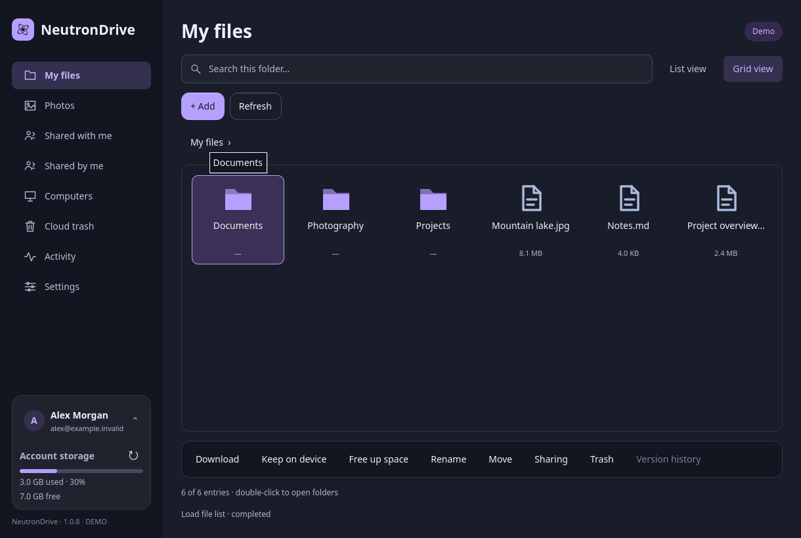
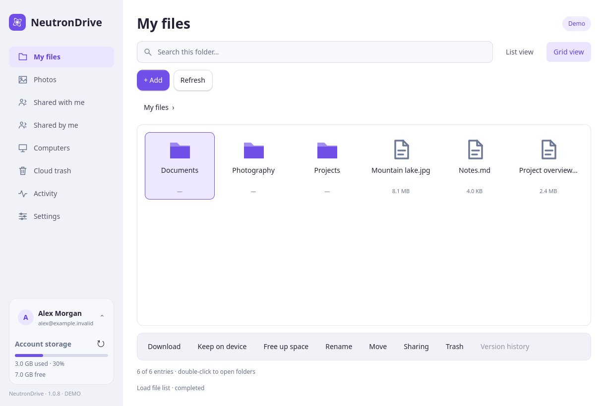
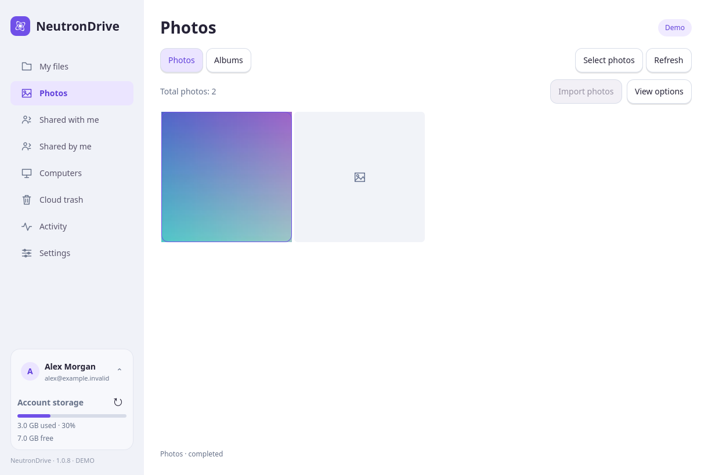
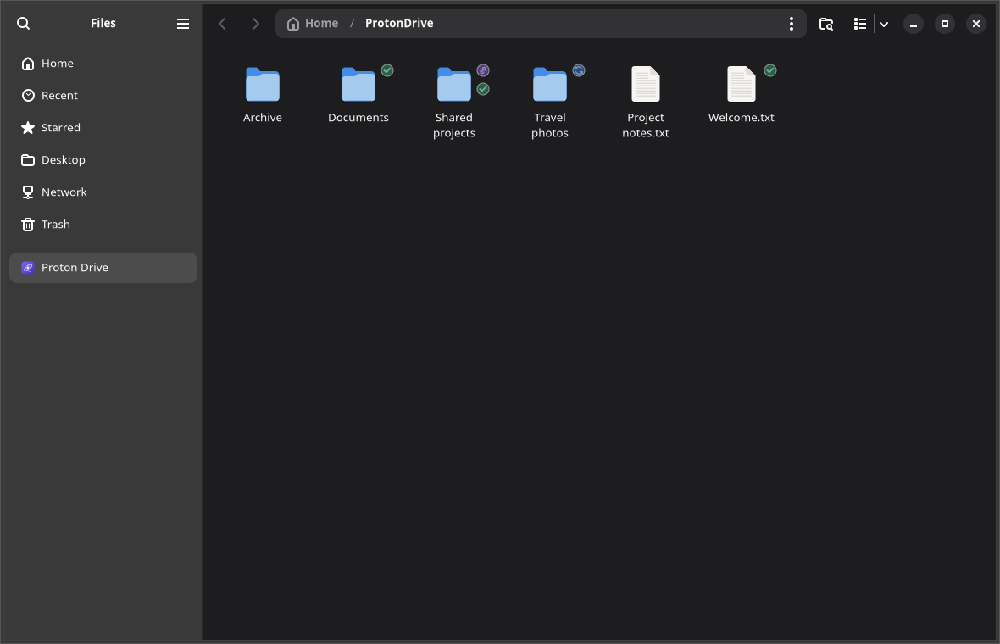
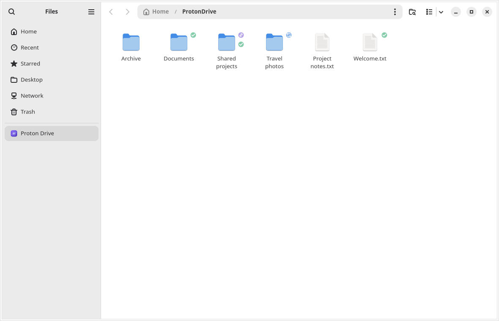

# NeutronDrive

[](https://github.com/SigmaCodez/NeutronDrive/releases)
[](#moving-from-the-retired-alpha-releases)
[](https://github.com/SigmaCodez/NeutronDrive/actions/workflows/ci.yml)
[](docs/RUST-MIGRATION.md)
[](desktop/README.md)
[](#install)
[](LICENSE)

An unofficial, open-source **Linux desktop client for Proton Drive**. Browse your
cloud files, synchronize folders in the background, keep selected items offline,
and manage photos, albums and sharing from a native Qt Quick interface.

**Version [1.0.8](https://github.com/SigmaCodez/NeutronDrive/releases/tag/v1.0.8).**
This update simplifies sign-in, navigation, file actions, photos and settings.
Advanced controls remain available when needed; existing sync and sharing safeguards
are preserved. Ubuntu 26.10 DEB checks remain part of the release test matrix.
Keep an independent backup of important files. Complete Windows/macOS feature
parity has not been reached.

NeutronDrive is not affiliated with, endorsed by, or officially supported by
Proton AG. It uses Proton's open-source SDK for account access, encryption and
service requests. The interface and icon are original.

Import an extracted Google Takeout photo/video export with a review before upload,
configure computer backup separately, and optionally support development on Ko-fi.
The built-in DEB/RPM updater safely restarts the app and previously running services.
See [feature details and limitations](docs/DESKTOP-FEATURES.md#beta-01-takeout-computer-and-donations)
and [update restart behavior](docs/DESKTOP-FEATURES.md#beta-01-update-restart).

## Interface and download progress

The Qt Quick interface provides a clearer content area,
consistent light/dark surfaces, roomier navigation and a wrapping file-action bar.
The following English previews use isolated synthetic data in the actual app.



[Light mode](docs/previews/design-polish/light-grid.png) ·
[Compact layout](docs/previews/design-polish/compact-files.png) ·
[Capture provenance](docs/previews/design-polish/capture.json)

Native file-manager integrations now support a **blue sync emblem** while
**Keep on device** downloads a file or folder. The green checkmark is shown once
content is available locally. Cancelled or failed transfers clear the progress
indicator; process-instance validation prevents stale blue emblems after a crash.
Snap and Flatpak still do not install native file-manager extensions.

## Light and dark appearance






[Compact layout](docs/previews/design-polish/compact-files.png) ·
[Capture version and hashes](docs/previews/design-polish/capture.json)

The app follows your system's light/dark preference. **Settings → Appearance**
also lets you choose System, Light or Dark manually. Theme changes apply immediately.

[Setup: sign in](docs/previews/development/setup-sign-in-light.png) ·
[Setup: choose folder, dark mode](docs/previews/development/setup-folder-dark.png) ·
[Sync settings](docs/background-demo.png) ·
[Computer backup](docs/previews/computer-backup-light.png) ·
[Online drive](docs/ondemand-demo.png) ·
[Sharing window](docs/previews/sharing-light.png) ·
[Activity progress](docs/previews/design-polish/light-activity-progress.png)

## In your file manager





The **Proton Drive** bookmark uses NeutronDrive’s icon. A **green checkmark**
means a file is available locally; a folder is marked when its contents are
fully available offline. A **blue sync emblem** indicates an active download. Use **Keep on device** to retain selected files or
folders and **Free up space** to remove eligible local cached copies. These
actions do not open the main window. A **sharing emblem** identifies directly shared folders and can appear beside the offline indicator. **Share** opens its separate sharing window.

These are GNOME Files (Nautilus) captures in English, with synthetic
example files and offline-status fixtures rendered by the real extension.
They illustrate the integration, not a live cloud download. Appearance varies
with the file manager and desktop theme. [Capture details](docs/FILE-MANAGER-PREVIEWS.json).

## New in 1.0.8

- Delete cached files locally without waiting for cloud requests; a durable queue verifies identities and revisions before moving cloud copies to trash.
- Follow current sync jobs, item-based progress, downloads, retries and pending cloud deletions in Activity.
- Set up computer folder backup with one folder picker; separate controls stop sync, remove a cloud backup or remove a computer while retaining local originals.
- Recognize shared folders with an additional file-manager emblem alongside offline/sync status.
- Use a cleaner account/storage card, consistent light/dark buttons and compact layouts that keep Settings and Cancel visible.
- Find the optional Ko-fi button discreetly in Settings.

Cloud deletion conflicts remain visible for review. Open/local edits are protected;
folder removal requires a verified empty cloud folder. General bidirectional
folder-deletion safeguards remain in place. New interface messages have German
and English translations, with English fallback in other catalogs.
[Behavior and test scope](docs/USABILITY-PROGRESS-VALIDATION.md).

## What you can do

- **Set up Proton Drive:** sign in through your browser, then choose a sync folder
  in the first-run assistant; the default is `~/ProtonDrive`.
- **Browse and transfer:** list/grid views, search within the current folder,
  upload/download, create folders, rename, move and recover trashed files.
  [Keyboard navigation](docs/KEYBOARD-NAVIGATION.md).
- **Use on-demand files:** cache directory metadata first; download file content
  when opened or marked **Keep on device**. Files and folders can be pinned
  recursively; **Free up space** removes eligible cached copies.
- **Synchronize local folders:** automatic background jobs, local filesystem
  notifications, remote events, pause/resume, retry and visible conflicts.
- **Back up computer folders:** register a Linux computer through the SDK and
  synchronize selected folders under Proton Drive's Computers section.
- **Manage photos:** a continuously scrolling timeline, total count, selection
  overlays, image viewer, albums and location links to OpenStreetMap. Incremental
  tiles preserve scroll position, retain nearby previews and load pages ahead;
  thumbnails are cached across sessions; first-time previews still depend on the network.
  [Photo viewer controls and navigation](docs/PHOTO-VIEWER.md).
- **Import Google Photos:** review an extracted Takeout export and upload photos/videos
  with matching date/location metadata. [Import guide and limits](docs/TAKEOUT-IMPORT.md).
- **Manage your account:** the lower-left user menu opens Settings, the Proton
  subscription dashboard, Proton Drive online and guarded sign-out.
- **Share:** view incoming/outgoing shares, create public links and send confirmed
  email invitations in a separate sharing window. Supported native file managers
  open that window directly.
- **Keep working in the background:** close to tray, login autostart, availability
  emblems and a Proton Drive favorite on supported desktops.
- **Check for updates:** daily or manual checks; native DEB and supported Fedora/openSUSE RPM
  packages support verified downloads, installation after system authorization,
  and a guarded app/service restart.

See [desktop features](docs/DESKTOP-FEATURES.md),
[file-manager support](docs/FILE-MANAGER-INTEGRATION.md),
[computer backup](docs/COMPUTER-BACKUP.md) and
[Windows feature comparison](docs/WINDOWS-PARITY.md) for the exact scope.

## Moving from the retired alpha releases

The stable version series starts at **1.0.0**. Users of retired alpha clients can download and install the current package
once if their old updater does not offer it. DEB, RPM and Arch packages use **epoch 1**, so
package managers correctly treat the release as an upgrade. Preferences, account
storage and sync data are retained. Future updates use the usual updater.
The old GitHub releases and tags are retired; Git history remains. Historical release notes describe their original versions.

## Install

DEB packages are provided for amd64 and arm64. The release checks install the
same DEB on Ubuntu 26.10 and test the Qt interface and Nautilus integration.
These container checks do not replace a full GNOME/Wayland desktop-session test.

Download from [GitHub Releases](https://github.com/SigmaCodez/NeutronDrive/releases).
The commands below use the **1.0.8 release assets**, not development artifacts.
Packages are independent community builds, not official Proton packages or store listings.

Snap Store publication is automated, but availability currently awaits Canonical’s
manual review of the application’s D-Bus interfaces. The downloadable Snap is
available with the GitHub release; a queued Store upload is not yet an installable
Store revision.

| Format | Intended systems | Important details |
| --- | --- | --- |
| DEB | Ubuntu 22.04+, Debian 12+, Mint, Pop!_OS | x86_64 and ARM64; ARM64 needs GLIBC 2.39 (e.g. Ubuntu 24.04+/Debian 13+) |
| RPM | Current Fedora and openSUSE | Separate distribution-specific x86_64 packages |
| Flatpak | Flatpak-enabled Linux distributions | Standalone downloaded-folder sync; no online placeholders |
| Snap | Systems with snapd | Standalone downloaded-folder sync; connect keyring and mount-observe |
| AppImage | x86_64 GLIBC desktops | Ubuntu 22.04+/Debian 12+ baseline; native helper for online files |
| Arch package / AUR recipe | Arch Linux, Manjaro | Downloadable package and PKGBUILD; **not published to the AUR** |

```sh
# Debian / Ubuntu (choose arm64 instead of amd64 if appropriate)
sudo apt install ./neutrondrive_1.0.8-1_amd64.deb

# Fedora
sudo dnf install ./neutrondrive-1.0.8-fedora-x86_64.rpm

# openSUSE
sudo zypper install ./neutrondrive-1.0.8-opensuse-x86_64.rpm

# Flatpak
flatpak remote-add --user --if-not-exists flathub https://flathub.org/repo/flathub.flatpakrepo
flatpak install --user ./neutrondrive-1.0.8-x86_64.flatpak
flatpak run io.github.SigmaCodez.NeutronDrive

# Snap (local unsigned package)
sudo snap install --dangerous ./neutrondrive_1.0.8_amd64.snap
sudo snap connect neutrondrive:password-manager-service

# AppImage
chmod +x NeutronDrive-1.0.8-x86_64.AppImage
./NeutronDrive-1.0.8-x86_64.AppImage

# Arch: install the downloaded package with dependencies
sudo pacman -U ./neutrondrive-bin-1.0.8-1-x86_64.pkg.tar.zst
```

Verify downloads against the release's `SHA256SUMS`. Release evidence includes
`BUILD_INFO.json`, `TEST_RESULTS.json` and native/SDK provenance. Individual
formats and architectures have different limits; testing does not cover every
Linux distribution or desktop. See [packaging](packaging/README.md),
[AppImage details](packaging/appimage/README.md), [AUR recipe](packaging/aur/README.md)
and [validation](docs/VALIDATION.md).

## First start and everyday use

1. Start NeutronDrive and complete browser sign-in. Enter credentials only on
   Proton's browser page, never in a chat or terminal command.
2. Choose an empty sync folder in the assistant, normally `~/ProtonDrive`.
   Completing setup starts the on-demand service and configures login startup.
3. Browse the cached structure. Use **Keep on device** on selected files/folders
   to download them for offline use; completed items receive green availability
   emblems where the file manager supports them.
4. Use **Free up space** to return eligible items to online-only storage.
   Use **Share…** to open NeutronDrive's sharing dialog for the selected item.

The normal folder presentation uses FUSE on Linux. File-manager support varies:
see the [integration matrix](docs/FILE-MANAGER-INTEGRATION.md), including optional
Dolphin components and fallback behavior. GNOME needs a tray-host extension for
a visible tray icon. Settings do not change your desktop's own language or theme.

**Automatic sync** also supports conventional local folder pairs. Do not target
an on-demand FUSE mount with an eager folder-sync job. Native keyring sessions
can be shared with other uses of the Proton CLI; signing out may sign out that
shared session. Flatpak can use a separate portal-protected session.

## Languages

The OS language is selected automatically, with English as the fallback.
**Settings → Appearance** allows a manual language choice; restart the app after
changing the language. The preference persists across starts.

25 language variants are included: English, German, French, Dutch, Spanish,
Latin American Spanish, Italian, Polish, Portuguese, Brazilian Portuguese,
Russian, Turkish, Catalan, Czech, Danish, Hungarian, Indonesian, Norwegian Bokmål,
Romanian, Slovak, Swedish, Greek, Belarusian, Simplified Chinese and Traditional Chinese.
Newer labels can still fall back to English; machine-assisted translations need
native-speaker review. No translation service is contacted at runtime.
[Translation status](docs/LOCALIZATION.md).

## Safety and current limits

Sync detects conflicting edits and uses recoverable trash for verified file
deletions. A changed counterpart, uncertain identity or delete-versus-edit case
requires resolution. Replaced local content can be retained in private backup
files; caches and local trash contain plaintext and need normal account protection.

Whole-folder deletion propagation remains guarded: the SDK cannot provide the
complete proof needed for safe subtree deletion. Renames are not tracked as
moves by folder sync. Remote writes have no conditional revision operation in
this CLI, so rechecks reduce races but cannot make updates atomic.

Other limits include no multi-account UI, no Proton Docs/Sheets export, no embedded
photo map. Public-link settings now support viewer/editor access, passwords,
expiration dates and editor resharing, with a fresh-state check before saving.
These checks are not an atomic server-side compare-and-swap. FUSE does not support every
filesystem operation (including `mmap`, hardlinks and arbitrary permissions).
Sandboxed packages have host-integration restrictions. Availability icons and
favorite decoration depend on the file manager and its version.

[Feature comparison](docs/WINDOWS-PARITY.md) · [Sharing and remaining gaps](docs/SHARING-AND-REMAINING-LIMITS.md) · [Security](SECURITY.md) ·
[Validation and known test limits](docs/VALIDATION.md) · [Updates](docs/UPDATES.md)

## Technology and the language chart

The application runtime is **Rust**: the UI controller, synchronization, transfers,
cache, services, preferences and update logic. **Qt Quick/QML** defines the native
interface; small **C++** adapters connect Qt/KDE APIs. Proton's pinned **TypeScript**
SDK bridge handles the upstream integration. **Python and shell** remain in build,
packaging and regression tooling; no Python/PySide application runtime is shipped.

GitHub previously counted about **1.5 MB of HTML from one Rust copyright-notice
file** as source: `packaging/licenses/rust/COPYRIGHT-library.html`. It is third-party
license documentation, not a web UI. The file stays in the repository and packages;
`.gitattributes` classifies license documentation and vendored dependencies so
GitHub's language chart reflects maintained source more accurately. Real Python,
QML, C++ and TypeScript source is not relabeled as Rust.

[Architecture](docs/ARCHITECTURE.md) · [Rust migration](docs/RUST-MIGRATION.md) ·
[Upstream SDK and licenses](docs/UPSTREAM.md)

## Build and contribute

Build prerequisites include Rust 1.98.0, a C++17 compiler and a matching Qt 6.10.2
SDK. Python runs the build/test helpers; Bun 1.4.2 builds the pinned Proton bridge.
Follow the [native frontend guide](desktop/README.md) and
[packaging instructions](packaging/README.md) for dependencies, offline vendored
Cargo builds, Qt preparation, runtime paths and verification.

[Contributing](CONTRIBUTING.md) · [Release checklist](docs/RELEASING.md) ·
[Open issues](https://github.com/SigmaCodez/NeutronDrive/issues)

NeutronDrive is [MIT licensed](LICENSE). Bundled dependencies keep their own
licenses and notices. Public screenshots use synthetic data and are refreshed
from the actual GUI; development previews are labeled separately from releases.

## Project homepage

The promotional website is configured for [neutrondrive.sigmacodez.dev](https://neutrondrive.sigmacodez.dev).
Its Next.js/React source and deployment documentation are in [website/](website/README.md).
Run `./deploy.sh` to deploy the website to the configured Docker server.
