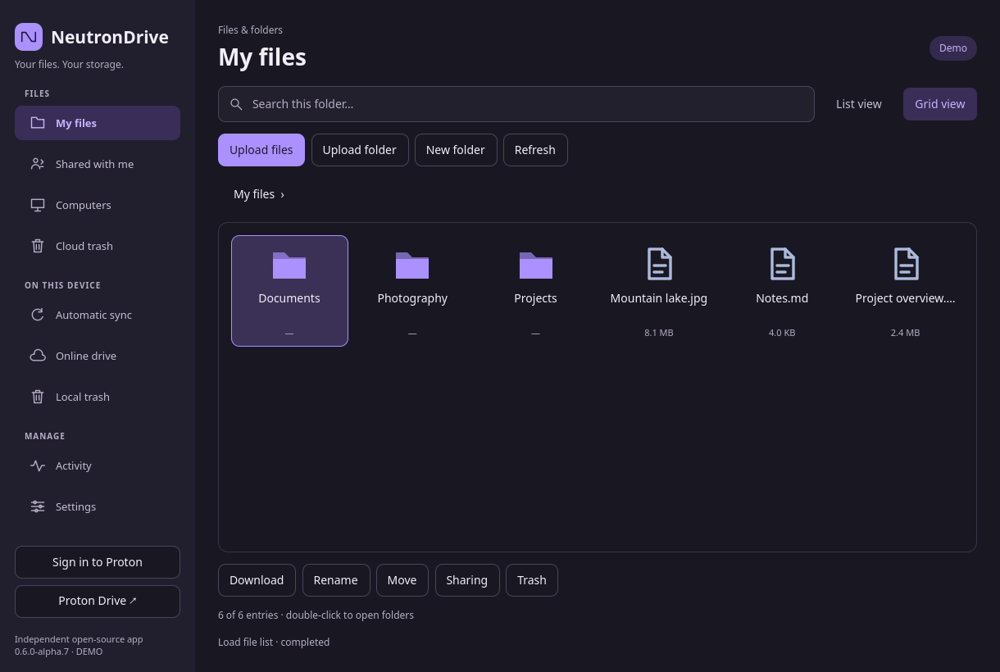
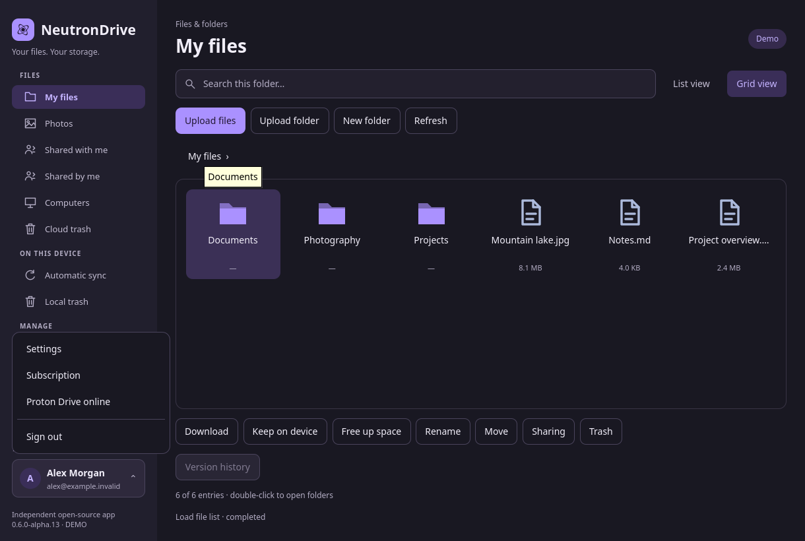
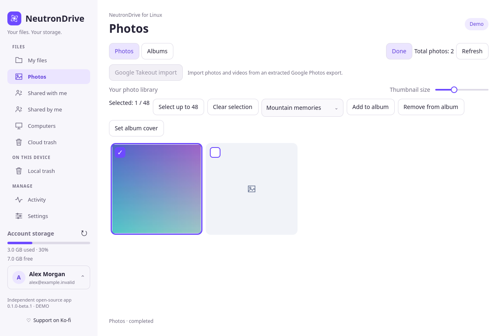

# NeutronDrive

[](https://github.com/SigmaCodez/NeutronDrive/releases)
[](https://github.com/SigmaCodez/NeutronDrive/actions/workflows/ci.yml)
[](docs/RUST-MIGRATION.md)
[](desktop/README.md)
[](#install)
[](LICENSE)

An independent, open-source **Linux desktop client for Proton Drive**. Browse your
cloud files, synchronize folders in the background, keep selected items offline,
and manage photos, albums and sharing from a native Qt Quick interface.

**Latest published version: [0.6.0 alpha15](https://github.com/SigmaCodez/NeutronDrive/releases/tag/v0.6.0-alpha15).**
This update caches photo thumbnails between sessions, loads more photos as you scroll,
opens sharing in a dedicated window, and simplifies sync and backup configuration.
This is alpha software; keep an independent backup. Complete Windows/macOS feature
parity has not been reached.

NeutronDrive is not affiliated with, endorsed by, or officially supported by
Proton AG. It uses Proton's open-source SDK for account access, encryption and
service requests. The interface and icon are original.

## Light and dark appearance

Fresh captures of the **alpha15 release GUI**, in English, using isolated
synthetic demo data. These are actual application renders, not mockups or a live
account. [Capture version, timestamp and hashes](docs/GUI-PREVIEWS.json).

### Dark mode






[Dark sign-in assistant](docs/previews/development/setup-sign-in-dark.png) ·
[Dark sync-folder assistant](docs/previews/development/setup-folder-dark.png)

### Light mode and photos




[Photo timeline](docs/previews/photos-light.png) ·
[Photo viewer](docs/previews/development/light-photo-viewer.png) ·
[Albums](docs/previews/albums-light.png) ·
[Sync settings](docs/previews/background-light.png) ·
[Computer backup](docs/previews/computer-backup-light.png) ·
[Sharing window](docs/previews/sharing-light.png) ·
[Online drive](docs/previews/online-drive-light.png) ·
[Version history](docs/previews/history-light.png)

The app follows your system's light/dark preference. **Settings → Appearance**
also lets you choose System, Light or Dark manually. Theme changes apply immediately.

## What you can do

- **Set up Proton Drive:** sign in through your browser, then choose a sync folder
  in the first-run assistant; the default is `~/ProtonDrive`.
- **Browse and transfer:** list/grid views, search within the current folder,
  upload/download, create folders, rename, move and recover trashed files.
- **Use on-demand files:** cache directory metadata first; download file content
  when opened or marked **Keep on device**. Files and folders can be pinned
  recursively; **Free up space** removes eligible cached copies.
- **Synchronize local folders:** automatic background jobs, local filesystem
  notifications, remote events, pause/resume, retry and visible conflicts.
- **Back up computer folders:** register a Linux computer through the SDK and
  synchronize selected folders under Proton Drive's Computers section.
- **Manage photos:** a continuously scrolling timeline, total count, selection
  overlays, image viewer, albums and location links to OpenStreetMap. Incremental
  tiles preserve scroll position, retain nearby previews and load pages ahead;
  thumbnails are cached across sessions; first-time previews still depend on the network.
- **Manage your account:** the lower-left user menu opens Settings, the Proton
  subscription dashboard, Proton Drive online and guarded sign-out.
- **Share:** view incoming/outgoing shares, create public links and send confirmed
  email invitations in a separate sharing window. Supported native file managers
  open that window directly.
- **Keep working in the background:** close to tray, login autostart, availability
  emblems and a Proton Drive favorite on supported desktops.
- **Check for updates:** daily or manual checks; native DEB packages support
  verified download and installation after system authorization.

See [desktop features](docs/DESKTOP-FEATURES.md),
[file-manager support](docs/FILE-MANAGER-INTEGRATION.md),
[computer backup](docs/COMPUTER-BACKUP.md) and
[Windows feature comparison](docs/WINDOWS-PARITY.md) for the exact scope.

## Install

Download from [GitHub Releases](https://github.com/SigmaCodez/NeutronDrive/releases).
The commands below use the **published alpha15 assets**, not development artifacts.
Packages are community alpha builds, not official Proton packages or store listings.

| Format | Intended systems | Important details |
| --- | --- | --- |
| DEB | Ubuntu 22.04+, Debian 12+, Mint, Pop!_OS | x86_64 and ARM64; ARM64 needs GLIBC 2.39 (e.g. Ubuntu 24.04+/Debian 13+) |
| RPM | Current Fedora and openSUSE | Separate distribution-specific x86_64 packages |
| Flatpak | Flatpak-enabled Linux distributions | Online files additionally require the native host helper |
| Snap | Systems with snapd | Connect Secret Service; use a native package for FUSE online files |
| AppImage | x86_64 GLIBC desktops | Ubuntu 22.04+/Debian 12+ baseline; native helper for online files |
| Arch package / AUR recipe | Arch Linux, Manjaro | Downloadable package and PKGBUILD; **not published to the AUR** |

```sh
# Debian / Ubuntu (choose arm64 instead of amd64 if appropriate)
sudo apt install ./neutrondrive_0.6.0-alpha15-1_amd64.deb

# Fedora
sudo dnf install ./neutrondrive-0.6.0-alpha15-fedora-x86_64.rpm

# openSUSE
sudo zypper install ./neutrondrive-0.6.0-alpha15-opensuse-x86_64.rpm

# Flatpak
flatpak remote-add --user --if-not-exists flathub https://flathub.org/repo/flathub.flatpakrepo
flatpak install --user ./neutrondrive-0.6.0a15-x86_64.flatpak
flatpak run io.github.SigmaCodez.NeutronDrive

# Snap (unsigned alpha package)
sudo snap install --dangerous ./neutrondrive_0.6.0-alpha15_amd64.snap
sudo snap connect neutrondrive:password-manager-service

# AppImage
chmod +x NeutronDrive-0.6.0-alpha15-x86_64.AppImage
./NeutronDrive-0.6.0-alpha15-x86_64.AppImage

# Arch: install the downloaded package with dependencies
sudo pacman -U ./neutrondrive-bin-0.6.0alpha15-1-x86_64.pkg.tar.zst
```

Verify downloads against the release's `SHA256SUMS`. Release evidence includes
`BUILD_INFO.json`, `TEST_RESULTS.json` and native/SDK provenance. Individual
formats and architectures have different limits; testing does not cover every
Linux distribution or desktop. See [packaging](packaging/README.md),
[AppImage details](packaging/appimage/README.md), [AUR recipe](packaging/aur/README.md)
and [validation](docs/VALIDATION.md).

## First start and everyday use

1. Start NeutronDrive and complete browser sign-in. Enter credentials only on
   Proton's browser page, never in a chat or terminal command.
2. Choose an empty sync folder in the assistant, normally `~/ProtonDrive`.
   Completing setup starts the on-demand service and configures login startup.
3. Browse the cached structure. Use **Keep on device** on selected files/folders
   to download them for offline use; completed items receive green availability
   emblems where the file manager supports them.
4. Use **Free up space** to return eligible items to online-only storage.
   Use **Share…** to open NeutronDrive's sharing dialog for the selected item.

The normal folder presentation uses FUSE on Linux. File-manager support varies:
see the [integration matrix](docs/FILE-MANAGER-INTEGRATION.md), including optional
Dolphin components and fallback behavior. GNOME needs a tray-host extension for
a visible tray icon. Settings do not change your desktop's own language or theme.

**Automatic sync** also supports conventional local folder pairs. Do not target
an on-demand FUSE mount with an eager folder-sync job. Native keyring sessions
can be shared with other uses of the Proton CLI; signing out may sign out that
shared session. Flatpak can use a separate portal-protected session.

## Languages

The OS language is selected automatically, with English as the fallback.
**Settings → Appearance** allows a manual language choice; restart the app after
changing the language. The preference persists across starts.

25 language variants are included: English, German, French, Dutch, Spanish,
Latin American Spanish, Italian, Polish, Portuguese, Brazilian Portuguese,
Russian, Turkish, Catalan, Czech, Danish, Hungarian, Indonesian, Norwegian Bokmål,
Romanian, Slovak, Swedish, Greek, Belarusian, Simplified Chinese and Traditional Chinese.
Newer labels can still fall back to English; machine-assisted translations need
native-speaker review. No translation service is contacted at runtime.
[Translation status](docs/LOCALIZATION.md).

## Safety and current limits

Sync detects conflicting edits and uses recoverable trash for verified file
deletions. A changed counterpart, uncertain identity or delete-versus-edit case
requires resolution. Replaced local content can be retained in private backup
files; caches and local trash contain plaintext and need normal account protection.

Whole-folder deletion propagation remains guarded: the SDK cannot provide the
complete proof needed for safe subtree deletion. Renames are not tracked as
moves by folder sync. Remote writes have no conditional revision operation in
this CLI, so rechecks reduce races but cannot make updates atomic.

Other limits include no multi-account UI, no Proton Docs/Sheets export, no embedded
photo map and no complete advanced-link settings. FUSE does not support every
filesystem operation (including `mmap`, hardlinks and arbitrary permissions).
Sandboxed packages have host-integration restrictions. Availability icons and
favorite decoration depend on the file manager and its version.

[Feature comparison](docs/WINDOWS-PARITY.md) · [Security](SECURITY.md) ·
[Validation and known test limits](docs/VALIDATION.md) · [Updates](docs/UPDATES.md)

## Technology and the language chart

The application runtime is **Rust**: the UI controller, synchronization, transfers,
cache, services, preferences and update logic. **Qt Quick/QML** defines the native
interface; small **C++** adapters connect Qt/KDE APIs. Proton's pinned **TypeScript**
SDK bridge handles the upstream integration. **Python and shell** remain in build,
packaging and regression tooling; no Python/PySide application runtime is shipped.

GitHub previously counted about **1.5 MB of HTML from one Rust copyright-notice
file** as source: `packaging/licenses/rust/COPYRIGHT-library.html`. It is third-party
license documentation, not a web UI. The file stays in the repository and packages;
`.gitattributes` classifies license documentation and vendored dependencies so
GitHub's language chart reflects maintained source more accurately. Real Python,
QML, C++ and TypeScript source is not relabeled as Rust.

[Architecture](docs/ARCHITECTURE.md) · [Rust migration](docs/RUST-MIGRATION.md) ·
[Upstream SDK and licenses](docs/UPSTREAM.md)

## Build and contribute

Build prerequisites include Rust 1.98.0, a C++17 compiler and a matching Qt 6.10.2
SDK. Python runs the build/test helpers; Bun 1.4.2 builds the pinned Proton bridge.
Follow the [native frontend guide](desktop/README.md) and
[packaging instructions](packaging/README.md) for dependencies, offline vendored
Cargo builds, Qt preparation, runtime paths and verification.

[Contributing](CONTRIBUTING.md) · [Release checklist](docs/RELEASING.md) ·
[Open issues](https://github.com/SigmaCodez/NeutronDrive/issues)

NeutronDrive is [MIT licensed](LICENSE). Bundled dependencies keep their own
licenses and notices. Public screenshots use synthetic data and are refreshed
from the actual GUI; development previews are labeled separately from releases.
