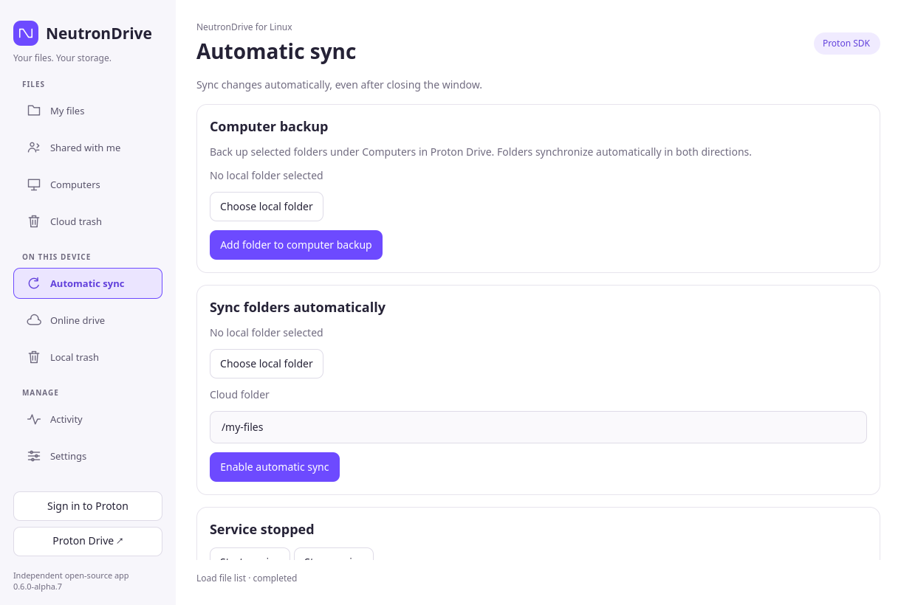
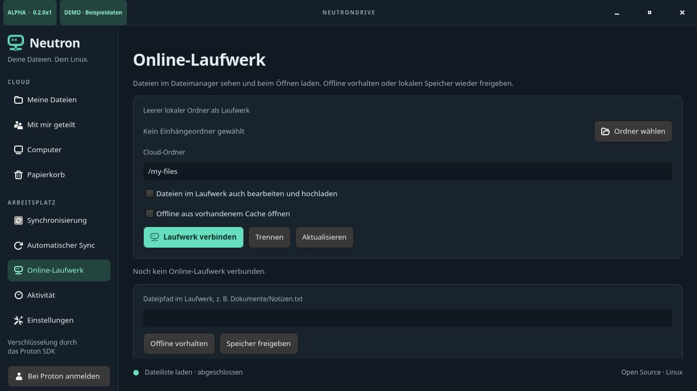

# NeutronDrive

An independent, open-source **Linux desktop client for Proton Drive**, with a
native Qt Quick/QML interface and Proton's open-source SDK/CLI as its encryption and account
backend. The interface follows the system language, with 25 Windows-matching language variants and an English fallback. See [localization and translation review status](docs/LOCALIZATION.md).

**Status: 0.6.0 alpha 7.** Automatic background synchronization, recoverable
bidirectional file deletions and real on-demand files are implemented. Full Windows/macOS feature parity is not yet reached.
Keep an independent backup while using this alpha. See the actual [validation record](docs/VALIDATION.md).

NeutronDrive is not affiliated with, endorsed by, or officially supported by
Proton AG. Proton names are used only to identify the compatible service. The
interface and icon are original; no Windows/macOS application code is copied.

## Interface development preview

The development branch adds a responsive grid view alongside the detailed file
list, inspired by the file-browser layout of
[narrrl/proton-drive-linux](https://github.com/narrrl/proton-drive-linux).
Use **List view / Grid view** above the files. Selection is shared between both
views; arrow keys, Ctrl+A, Ctrl-click and double-click folder navigation work in
both. The view choice lasts for the current application session. Grid tiles use
file/folder icons, not photo thumbnails.


[Dark grid](docs/previews/files-grid-dark.png) ·
[Detailed list](docs/previews/files-list-light.png) ·
[Automatic sync](docs/previews/background-light.png) ·
[Online drive](docs/previews/online-drive-light.png) ·
[Photos](docs/previews/photos-light.png) ·
[Version history](docs/previews/history-light.png) ·
[Capture details](docs/previews/capture.json)

These are actual development GUI captures with English synthetic demo files.
This change is not included in the published alpha7 packages. Rust, Qt Quick/QML
and the official Proton SDK are retained. The development branch also adds a native tray with sync-service controls, a
live sync overview, paginated cloud Photos with thumbnails and downloads, and
file version history with guarded restore requests. See [desktop feature details
and limits](docs/DESKTOP-FEATURES.md). This is not a claim of complete reference-project
or Windows feature parity.

## Published alpha7 interface


Actual alpha7 GUI, captured in English using isolated synthetic data; no live account or personal files.
[Preview build and capture details](docs/GUI-PREVIEWS.json).

[Current dark appearance preview](docs/demo-dark.png) · Appearance follows the desktop setting or your manual preference.

The application runs in Rust, including the Qt controller,
background synchronization, transfers, recoverable trash, online-drive/FUSE
services, preferences and updates. Qt Quick/QML and the pinned Proton SDK remain.
Python is used for build and regression tools, not the application runtime.
The old Python UI modules have been removed; compatibility adapters are retained
only under `tests/core_contract` for native-core regression tests. Native tests
pass on x86-64 and ARM64; current-source DEB, RPM, Flatpak, Snap, AppImage and
Arch package checks and authorized live sync/FUSE/trash tests have passed.
Alpha7 packages include the completed native runtime migration.
See [migration status and evidence](docs/RUST-MIGRATION.md).

## Language

The interface automatically uses your operating system's language at startup.
Settings → Appearance also offers a manual language
selection and Light/Dark/System appearance. These choices persist across starts;
appearance changes immediately, while language changes require an app restart.
Restart NeutronDrive after changing your system language when using System setting. Unsupported languages
fall back to English; no translation service or model is contacted at runtime.

The 25 supported variants are English, German, French, Dutch, Spanish,
Latin American Spanish, Italian, Polish, Portuguese, Brazilian Portuguese,
Russian, Turkish, Catalan, Czech, Danish, Hungarian, Indonesian, Norwegian Bokmål,
Romanian, Slovak, Swedish, Greek, Belarusian, Simplified Chinese and Traditional Chinese.
These match the upstream Windows client's language list. Established controls have complete catalogs; newly added desktop-feature labels
currently fall back to English outside English/German. Initial machine-assisted
translations still need full native-speaker review.
See [localization details](docs/LOCALIZATION.md).

## Features

- Browser-based sign-in on `account.proton.me`; no password field in NeutronDrive.
- Protected session storage through Linux Secret Service or the Flatpak Secret
  portal; the official CLI also supports `pass` for native installations.
- Browse My files, shared files, computer backups and trash; search the open folder.
- Upload/download files and folders, create folders, rename and move items.
- Restore unambiguous trash entries; move files to trash without permanent deletion.
- Create, copy and revoke public read-only links.
- SHA1 content comparison, conflict detection, a persistent baseline and retained
  local backup versions in the automatic synchronization engine.
- Baseline-verified file deletion propagation to Proton trash or recoverable local
  trash, with a local restore page and delete-versus-edit conflicts.
- Automatic two-way background sync: local inotify notifications, remote Drive
  events, persistent jobs, pause/resume, retry/backoff and startup reconciliation.
- A real FUSE online drive: metadata-only directory entries, verified download on
  open, individual-file offline pinning and eviction to online-only state.
- Optional writes through the mounted drive, including editor temporary-save
  replacement, new revisions, folders, rename/move and trash.
- Desktop autostart, a native D-Bus mount service and Flatpak background portal.
- Cancellation, timeouts, serialized backend calls and in-session activity history.
- Built DEB, Fedora/openSUSE RPM, Flatpak, Snap, AppImage and Arch packages with
  a checksum-pinned bundled backend; ARM64 DEB is included alongside x86_64 packages.

The bundled **NeutronDrive SDK bridge** is built from a pinned public
Proton SDK/CLI commit with published Drive-event and computer-backup extensions. It identifies
itself as `external-drive-neutrondrive`; Proton's SDK handles cryptography and
service requests. Source patches, dependency integrity and build provenance are
provided. No Windows/macOS reverse engineering was necessary. [Sources and compatibility](docs/UPSTREAM.md).

## Install

Use a package from this repository's [releases](https://github.com/SigmaCodez/NeutronDrive/releases)
or build it using [packaging instructions](packaging/README.md). GitHub Actions also
provides build artifacts when the corresponding job succeeds. Unsigned alpha
packages are not official Proton packages, Flathub listings or Snap Store releases.

| Format | Intended systems | Notes |
| --- | --- | --- |
| DEB | Ubuntu 22.04+, Debian 12+, Mint, Pop!_OS | Native Rust, bundled Qt 6, libsecret, FUSE 3; ARM64 requires GLIBC 2.39 |
| RPM | Current Fedora, openSUSE | Distribution-specific dependency names |
| Flatpak | Flatpak-enabled distributions, including Arch/Manjaro and immutable desktops | GNOME 50; online drive additionally needs the native helper |
| Snap | snapd-enabled distributions | Connect `password-manager-service`; online drive needs native package |
| AppImage | x86_64 GLIBC desktops, Ubuntu 22.04+/Debian 12+ | Bundled Rust/Qt; persistent private runtime cache; native helper for online drive |
| Arch package / AUR recipe | Arch Linux, Manjaro | `neutrondrive-bin` PKGBUILD; AUR publication pending account setup |

Application packages use the Rust frontend and contain no Python/PySide runtime.

Native x86_64 retains Ubuntu 22.04+/Debian 12+ coverage. The official ARM64 Qt
wheels require GLIBC 2.39: use Ubuntu 24.04+, Debian 13+ or an equivalent runtime
on ARM64. Older ARM64 native distributions require a separately built Qt runtime.

Both x86_64 and aarch64 are represented in build recipes. Artifact availability
and actual validation differ by architecture and format; see the validation
record. The source-built x86_64 backend uses Bun's baseline target without AVX2. There is no claim
that every distribution, CPU, desktop or sandbox has been tested.

After downloading a matching package:

```sh
# Debian/Ubuntu
sudo apt install ./neutrondrive_0.6.0-alpha7-1_amd64.deb

# Fedora (use the Fedora artifact)
sudo dnf install ./neutrondrive-0.6.0-alpha7-fedora-x86_64.rpm

# openSUSE (use the openSUSE artifact)
sudo zypper install ./neutrondrive-0.6.0-alpha7-opensuse-x86_64.rpm

# Flatpak
flatpak remote-add --user --if-not-exists flathub https://flathub.org/repo/flathub.flatpakrepo
flatpak install --user ./neutrondrive-0.6.0a7-x86_64.flatpak
flatpak run io.github.SigmaCodez.NeutronDrive

# Snap (unsigned alpha package)
sudo snap install --dangerous ./neutrondrive_0.6.0-alpha7_amd64.snap
sudo snap connect neutrondrive:password-manager-service
```

Additional formats:

```sh
# Portable x86_64 AppImage
chmod +x NeutronDrive-0.6.0-alpha7-x86_64.AppImage
./NeutronDrive-0.6.0-alpha7-x86_64.AppImage

# Arch/Manjaro: review the PKGBUILD, then build as a regular user
# Requires base-devel and git.
git clone https://github.com/SigmaCodez/NeutronDrive.git
cd NeutronDrive/packaging/aur/neutrondrive-bin
makepkg -si
```

[AppImage runtime/cache details](packaging/appimage/README.md) ·
[Arch installation and AUR publication status](packaging/aur/README.md).
The AUR recipe is available on GitHub; it is not yet listed on aur.archlinux.org.
All release downloads are covered by `SHA256SUMS`.

Launch **NeutronDrive** from your application menu. Unlock the desktop keyring,
select **Sign in to Proton** (or its translation in your system language) and finish in the browser. The CLI opens the
browser automatically; the app's fallback login button is needed only if it did
not open. A sign-in link is single-use: opening it again after completion can
produce “Invalid code”, even though the app session is already authenticated.
Refresh the file list to check the session before starting another login.

Native NeutronDrive and other native uses of the official CLI normally share
the same keyring session. Signing out can therefore sign out that shared CLI
session. Flatpak can use a separate, portal-protected credential store and may
need its own browser sign-in. Do not run a separate CLI process concurrently
with NeutronDrive operations against the same cache.

## Run from source

The application runs as a Rust executable with Qt Quick/QML. Building requires
Rust 1.98.0, a C++17 compiler and a matching Qt 6.10.2 development SDK. Python is
used by the download, packaging and test helpers, not by the running application.
See [`desktop/README.md`](desktop/README.md) for SDK preparation and native tests.

For Debian or Ubuntu, install the build tools and runtime libraries:

```sh
sudo apt install python3 g++ binutils libegl1 libopengl0 libgl1 libxkbcommon-x11-0 libxcb-cursor0 libxcb-icccm4 libxcb-image0 libxcb-keysyms1 libxcb-render-util0 libsecret-1-0 libgssapi-krb5-2 libbrotli1 gnome-keyring xdg-utils fuse3
rustup toolchain install 1.98.0 --profile minimal --component rustfmt --component clippy
python3 packaging/qt_runtime.py --dest build/qt
export QMAKE=/absolute/path/to/your/Qt-6.10.2-SDK/bin/qmake
export CARGO_TARGET_DIR="$PWD/build/native-qt-target"
(cd desktop && cargo build --locked --offline)
bin/neutrondrive --demo
```

Replace `QMAKE` with the actual executable in your matching Qt SDK. The source
launcher selects the debug executable in `CARGO_TARGET_DIR`; set
`NEUTRONDRIVE_NATIVE_PROFILE=release` for a release build, or
`NEUTRONDRIVE_NATIVE_EXECUTABLE=/absolute/path/to/neutrondrive-qt` for an explicit
binary. It does not compile or download anything at application startup.

For real account operations, build the current pinned Proton bridge using Bun
1.4.2, or provide an already verified compatible bridge with `--cli`:

```sh
python3 scripts/build-backend --output build/backend/proton-drive
bin/neutrondrive --diagnose --cli "$PWD/build/backend/proton-drive"
bin/neutrondrive --cli "$PWD/build/backend/proton-drive"
scripts/check-native-qt
```

The older unmodified Proton CLI does not expose the event protocol needed for
background synchronization. No Proton password is needed in an environment file.
For graphics drivers unable to initialize Qt Quick's GPU renderer, use
`QT_QUICK_BACKEND=software bin/neutrondrive --demo` (or `neutrondrive` for an
installed package).

The build helper fetches checksum-pinned Qt archives. The native application
loads only their C++ libraries and QML resources; it does not use PySide or
PyGObject. Rust dependencies are vendored and Cargo builds offline. Portable
package builds must additionally pass the native ELF baseline and provenance
checks in `scripts/build-native-qt`.

## Synchronization safeguards

The desktop interface uses automatic synchronization only. Configure folder pairs
under **Automatic sync**; no separate manual preview/execution page is needed.

New files and empty folders can travel in either direction. When an established
baseline shows that only one file changed, its update can travel to the other
side. Remote updates are downloaded into private staging, checked and installed
without blindly replacing a concurrently created file. A replaced local file is
retained beside it as `.neutrondrive-backup-<random-id>`; these files are excluded
from sync. They may contain sensitive plaintext and need the same protection as
the original local folder.

Different contents on both sides and ambiguous names require manual resolution.
Confirmed deletions propagate only when the remaining counterpart still matches
the last shared baseline, including its identity. Delete-versus-edit and
delete-versus-replacement cases remain conflicts. Renames are not tracked as moves.
The SDK provides Drive events but no conditional revision writes through this
CLI contract. A recheck reduces write races but
cannot make remote updates atomic; uploads of an existing file create a new
remote revision rather than discarding its history.

State is stored under `$XDG_STATE_HOME/neutrondrive` or
`~/.local/state/neutrondrive` with directory permissions `0700`. Sync baselines
contain relative names and hashes, not account credentials. Resetting a baseline
changes conflict decisions; do not delete it to force an overwrite.

## Automatic synchronization

Open **Automatic sync**, choose an existing local folder and a remote folder,
then add the job. An initial reconciliation establishes the baseline. Subsequent
changes are triggered by Linux inotify and SDK Drive events; there is no periodic
full remote-tree scan. Directory metadata is cached and affected parents are
invalidated. Actual reconciliations hash the local tree. Jobs and pending work
survive restarts; failures retry with backoff. Conflicts remain visible and are
not overwritten. Pause/resume and manual retry are available per job.

Closing the native window leaves the daemon running. **Settings → Autostart**
starts it at the next desktop login. Flatpak asks the Background portal for
permission; its hidden primary process keeps the sandbox alive. This depends on
the desktop portal implementation. `--sync-status` and `--stop-background` provide
headless control. No tray icon is provided. Deletions follow the same verified
trash policy described above. Renames are not tracked as moves; ambiguous
moves are retained as conflicts.



## Deletions, trash and recovery

After a successful common baseline, deleting a local file moves its unchanged
cloud counterpart to **Proton trash**. Deleting a cloud file moves its unchanged
local counterpart to a recoverable **local trash**. An absent item on first sync
is still treated as a new item on the other side. Baselines from version 0.2 are
upgraded only after both sides are verified together; a one-sided absence against
an old baseline remains a conflict.

Deleting an entire folder remains a conflict before any counterpart is changed.
The pinned Proton SDK cannot enumerate a directly trashed folder, so a complete
subtree proof is unavailable. Individual file deletions inside existing folders
are supported. Restore the missing folder to resume normal synchronization, or
resolve the two sides manually after inspecting their contents. Replaced roots,
trashed root ancestors, moved cloud identities and uncertain metadata also block
destructive reconciliation. A durable deletion journal makes retries
and restarts check the original operation before doing any further work.

Open **Local trash** to see NeutronDrive's local receipts and restore an
item at its original location. Restoration never overwrites an occupied path;
a changed root, parent or trash payload requires manual recovery from the shown
trash path. **Restore / check recovery** retries an interrupted operation after
validating its retained data; it also verifies a restore that already completed
before a journal write was interrupted. Local trash uses a private, same-filesystem desktop trash when
available, otherwise an application-managed location outside the sync root.
The app never permanently deletes trash or empties it automatically. Desktop
trash managers can independently restore or empty standard trash entries.

Use **CLOUD → Trash** for cloud restoration, or Proton's web app if names
are ambiguous. Restoring an item while its job is active synchronizes it again.
Local trash and its registry contain plaintext data and paths; keep them private.
There is no server-side conditional trash operation in this CLI: final checks
reduce concurrency races, while recovery relies on retained trash contents.

## Online drive and offline files

Open **Online drive**, choose an empty local mount directory and an existing
remote directory, then mount. File-manager listings show remote sizes without
downloading content. Opening a file downloads and verifies it; pinning a relative
file path keeps it for an explicit offline mount. **Free up space** unpins
and removes cached content. Pinning applies to individual files, not whole trees.

Mounts are read-only by default. Enable write access before mounting to save
through ordinary Linux applications. Failed or conflicting writes retain local
content and a recovery journal; the page displays their location. Do not delete
recovery files until their contents have been recovered. The local cache contains
plaintext and is private to the user. Only one mount is supported per service.
Direct I/O is used: applications requiring `mmap`, hardlinks, symlinks, arbitrary
chmod/timestamps or simultaneous cross-directory move-and-rename may not work.
The latter can be performed as separate move and rename operations.

Native DEB/RPM include the D-Bus helper and its activation file. **Flatpak needs
that native package installed on the host for online files**; the helper has its
own native keyring session and can request its own browser login. No unrestricted
host command permission is granted. On Arch/Manjaro, install from source with
a compatible native Rust/Qt build, `libsecret`, `fuse3` and
install the D-Bus activation file for the resulting launcher. Flatpak background
folder sync itself does not require this helper.

The strict Snap supports browsing, transfers and background folder sync. Its
confinement does not provide the required unprivileged FUSE mount helper, so the
online drive is explicitly unavailable there. Use the native DEB/RPM for online
files; connecting extra interfaces does not remove this limitation.
FUSE mounts cannot be used as automatic sync roots, and overlapping jobs or
mounts are rejected.



## Known limits

- No multi-account UI or automatic updater.
- No integrated Photos timeline/albums, Proton Docs/Sheets export, historical
  revision browser, member invitations or advanced link settings.
- Native Proton documents cannot be downloaded as regular files by this CLI.
  Transfer summaries report skipped items; sync reports unsupported files.
- Duplicate names in trash cannot be resolved by the CLI's name-only restore
  interface and are blocked. Use the Proton web app for those entries.
- Local upload paths containing `*`, `?`, `[` or `{` are rejected because the
  upstream CLI expands them as globs. Sync excludes such names. Symlinks and
  special files are excluded rather than followed.
- Regular upload/download activity shows the operation and final counts, not
  invented percentage progress; the JSON CLI has no progress event stream.
- Proton may change SDK/API compatibility, including the announced cryptographic
  migration. Compatibility must be retested when the pinned backend changes.

See [architecture](docs/ARCHITECTURE.md), [security](SECURITY.md) and
[contributing](CONTRIBUTING.md). The NeutronDrive code is [MIT licensed](LICENSE).
The bundled CLI retains its [upstream MIT notice](packaging/licenses/proton-drive-MIT.txt).

### 0.6.0 alpha 2 refinement

Small prerelease increment: a light Qt Quick interface, grouped navigation and
font-independent line icons. Remote cache invalidation now runs in Rust, retaining
conservative handling of moved/deleted folders and unknown cloud events.

### 0.6.0 alpha 3 refinement

The desktop now exposes automatic sync only. The interface follows the desktop
light/dark preference at startup and while running, through the Settings portal
with Qt color-scheme/palette fallback. Desktop settings are never changed.

### 0.6.0 alpha 4 refinement

Cloud-event routing and bounded pending-event queue decisions now run in Rust.
The host retains locks, guarded I/O and durable acknowledgement. No extra C layer
is introduced without a demonstrated benefit.

## Update checks

Settings → Updates can check GitHub daily or on demand, with a prerelease
channel option. Native DEB installations also support verified downloads and
installation after system authorization. Other formats show the release page
and use their normal package/update workflow. See [update behavior and limits](docs/UPDATES.md).

## Computer backup

Automatic sync now includes a Computer backup card that registers a Linux
computer through the official SDK and synchronizes selected folders under
Proton Drive's Computers section. It requires the new source-built SDK bridge
and Rust core, included in alpha7 packages. See
[setup and safety behavior](docs/COMPUTER-BACKUP.md) and the
[Windows feature comparison](docs/WINDOWS-PARITY.md) for remaining gaps.

## Release maintenance

Every release updates the English GitHub documentation and captures new English
previews from that release’s actual GUI. See the [release checklist](docs/RELEASING.md).
