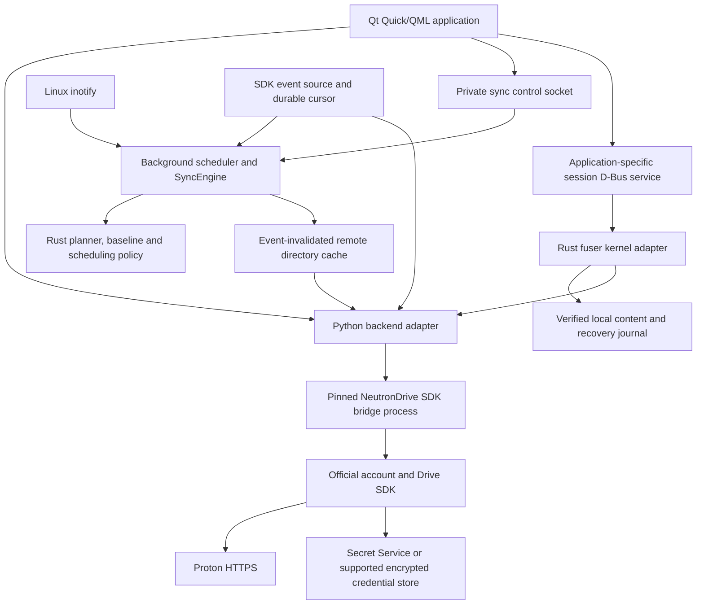

# Architecture: 0.5 alpha

The GUI is a native Qt application with a worker executor. Its demo backend is
explicitly separate from authenticated operations. The source-built bridge uses
`external-drive-neutrondrive@0.2.0-alpha`; its exact source/compiler/dependency
provenance is documented in [UPSTREAM.md](UPSTREAM.md).

## Qt interface and callbacks

Qt Quick/QML provides all six pages through a PySide6 controller. A queued Qt signal carries worker results
to the GUI thread. Dialogs are asynchronous; confirmations default to cancel.
A same-user local socket and lock reactivate an existing or hidden window.
The Qt timer explicitly services pending Gio portal callbacks. GTK is not loaded
by the UI; D-Bus helper and portal adapters retain PyGObject.

## Rust decision boundary

The required Rust shared library decides plans, deletion eligibility, convergence,
baseline advancement, scheduling, bounded retry, echo suppression and event batch/delivery validation. Python
collects observations and executes guarded effects. Fresh remote absence proofs
are requested by Rust and supplied only after host-side checks. See
[RUST-MIGRATION.md](RUST-MIGRATION.md) for the exact migration scope.

## Backend and process boundaries

`backend.py` adapts CLI JSON without invoking a shell. It validates remote names,
uses UID paths where supported, passes explicit transfer conflict strategies,
and checks every operation result and transfer summary. Exit code zero does not
make partial failures successful. Literal `undefined` is accepted only for the
upstream sharing commands whose result is optional. Browser login delivers its
validated HTTPS sign-in URL while the process is still running.

CLI calls share a private cross-process lock because the GUI, sync daemon and
filesystem service use the same account/cache. Lock waits and process execution
are bounded and cancellable. Within a consumer, event polling shares the backend
mutex but has its own cancellation token; stopping events does not cancel an
unrelated transfer. The SDK retains responsibility for account sessions,
cryptography, encrypted cache, API requirements and remote transfers.

## Events and automatic reconciliation

`packaging/bridge/` adds `events poll` and diagnostic `events watch`. The public
SDK `iterateEvents` API supplies volume events, opaque cursors, refresh and
removal signals. No recursive listing is used to discover whether something
changed. Each long-running consumer has persisted cursor state; separate sync
and filesystem processes may subscribe independently, with CLI access serialized
through the backend lock.

`events.py` validates a complete JSON batch and delivers identifier/status-only
`RemoteEvent` objects. The scheduler must persist accepted pending work before
its callback returns. The source then atomically writes its cursor file with
mode 0600 in a private directory. Failed callbacks, malformed batches, cancelled
operations and failed persistence leave the old cursor for at-least-once replay.
Status events report startup, recovery and transient failure without raw API
responses. Poll cadence is at least 30 seconds, with error backoff up to ten
minutes. An empty successful batch causes no tree scan.

`background.py` persists selected jobs and operates one reconciliation at a time.
It starts with a scan, then responds to inotify, actual SDK events, explicit user
commands, overflow/recovery signals or retries of unfinished work. Local changes
are debounced. Known node/parent UIDs scope remote changes; unresolved ancestry
is durably queued and resolved through metadata outside the acknowledgement
callback. Events that cannot be safely excluded trigger conservative recovery.
Remote directory listings are cached and invalidated by affected events/writes;
identity and revision checks still reach the backend. The cache does not expire
on a timer or cause periodic remote tree crawling.

Jobs pin the account root UID, remote folder UID and local directory identity.
Overlapping roots, unsafe symlinks and local FUSE/Autofs/nested-mount roots are
rejected. Account/root replacement blocks a job. Pause/resume and status use a
private Unix socket with same-user credential checks. A restart reconciles jobs
again so work accepted before a crash is not silently lost.

## Sync execution and conflict policy

`sync.py` provides both reviewed manual plans and scheduler execution. A plan
captures local file identity/content, remote revision/content and baseline
generation. Execution refuses stale/reused plans and changed root/account
identity. Files are staged privately using descriptor-relative no-follow access,
installed without replacement where required, and backed up before replacement.
Only confirmed converged entries advance the baseline; errors and conflicts do
not become successful sync state. Local echo suppression also considers ctime
so an edit with restored mtime is not ignored.

Baseline version 2 binds each converged path to local device/inode, cloud UID and
revision, type/content and known descendants. Old version 1 entries are promoted
only after verified two-sided convergence; missing-side v1 entries remain
conflicts. Deletion of a known path propagates only to its unchanged counterpart.
The production backend cannot enumerate directly trashed folders. Whole-folder
deletion therefore remains a conflict before any mutation; no child cascade is
attempted. Individual file deletions in retained directories are supported. Fresh absence and
identity checks bypass cached listings, and moved remote UIDs or missing/trashed
root ancestors block deletion.

Public SDK nodes expose `trashTime`, while SDK events expose `isTrashed`.
`Node.parse` validates the serialized date and normalizes a semantic trash flag
for all consumers; malformed timestamps fail closed.

Pending deletion records are persisted before mutation with an operation UUID.
Retries verify the original missing side and target proof; confirmed absence on
both sides completes the journal without resurrecting an item. Changed outcomes
remain conflicts. Successful trash and ambiguous trash failures invalidate the
remote directory cache; folder events invalidate cached descendants as well.

`local_trash.py` uses descriptor-relative no-follow traversal and atomic
`renameat2(RENAME_NOREPLACE)` into same-filesystem trash. Standard desktop trash
uses freedesktop `.trashinfo` metadata; a private managed fallback stays outside
the sync root. Both modes keep private receipts under `local-trash/entries` in
the app state directory. The GUI lists only these receipts. Restoration checks
the payload and original root/parent identity and refuses existing targets.
Interrupted moves retain a recovery record. No copy-then-delete fallback or
permanent-deletion endpoint is provided. An external desktop trash manager may
restore or empty standard trash, which the registry reports on inspection.

Linux rename and the remote CLI do not provide an atomic identity-conditional
trash operation. Pre/post checks reduce source-replacement races and retain
recoverable data, but this is not a complete distributed transaction. A local
change during a run remains pending or conflicted rather than being swallowed
as the daemon's own write. Network failures retain pending work with backoff.
The CLI does not expose an atomic compare-and-swap upload, so pre/post checks
reduce conflict risk but cannot eliminate a concurrent remote writer's race.

## On-demand files and recovery

`core/src/ondemand_fs.rs` owns the filesystem model; `core/src/fuse.rs` exposes it through the native Rust kernel adapter. `core/src/mount_manager.rs` owns lifecycle, status, mount validation and relative-path commands. The Python modules are transitional desktop call/thread bindings.
The mount is read-only by default and restricted to My Files. Directory entries
are metadata, not zero-filled placeholder files. Opening an uncached file
hydrates the complete content through the official SDK and verifies size/SHA1
and remote revision before use. Kernel writeback caching is disabled. Directory
metadata refreshes on access after its short TTL or event invalidation; no
background content crawler hydrates the tree.

Cached plaintext is stored in private user-owned files. Pinning retains verified
file content for explicit offline use; absent offline content produces an error.
Offline mounts are read-only, recursive folder pinning is not implemented, and
there is no automatic cache quota/eviction policy. Explicit eviction requires a
clean, closed, unpinned file. A mount/cache cannot be used concurrently by two
filesystem instances or recursively selected as a sync root.

Write access is opt-in. Edits use private working copies and fsync'ed recovery
journals. `flush`/`fsync` own upload and error reporting; closing a handle does not
silently perform a first upload whose failure could be hidden from the caller.
Pre/post revision checks guard replacement, but server-side atomic conditional
writes are unavailable. Uncertain or interrupted writes preserve local recovery
bytes and are not automatically replayed after a crash. Editor-style replacement
can require multiple cloud operations and can leave both source and destination
on interruption. Explicit filesystem deletion moves items to Proton's trash.
Arbitrary POSIX modes, links, xattrs, timestamp changes and every atomic rename
variant are not supported.

## Desktop and sandbox lifecycle

`desktop_service.py` exposes a narrow application-specific session D-Bus service
for mount/unmount, status, login, pin/evict and refresh. It checks the caller's
Unix UID, bounds JSON request size and provides no arbitrary command or shell
endpoint. The helper owns the mount and event invalidation so closing the GUI
need not destroy an online drive. Unsafe account changes block the mount;
unsaved content stays in recovery. Busy mounts are not forcibly detached.

Native packages install D-Bus activation and an optional user systemd unit.
The GUI can create a managed XDG autostart entry; `--background` restores saved
mounts and runs selected sync jobs. A missing optional mount helper does not
prevent the sync daemon from starting. Users should choose one autostart method.

Flatpak requests persistence/autostart through the Background portal and browser
launch through the desktop portal. Actual FUSE mounting belongs to the native
host helper, reached only over its declared D-Bus name; no general host-spawn
permission is granted. The host helper and Flatpak may use separate encrypted
credential stores and require separate browser sign-ins. Unprivileged FUSE
mounting is currently unsupported inside strict Snap confinement, so the Snap
UI disables online-drive mounting and directs users to a native DEB/RPM package.
Snap browsing, transfers and background synchronization remain available with
the required keyring interface.

## Validation boundaries and remaining work

The suite covers subprocess handling, cursor acknowledgement/replay, event
scoping, scheduler races, local inode/content conflicts, cache verification,
recovery, service requests and opt-in Qt/FUSE smoke flows. Unit tests use fake
backends and no account credentials. Source builds type-check the full CLI/SDK
and run the bridge event/branding tests. Live account checks and kernel-mounted
filesystem checks are separate evidence; a green synthetic test or package build
does not certify an installed distribution, sandbox or CPU architecture.

Remaining limits include Photos/Docs/Sheets and shared/computer automatic
subscriptions, multi-account UX, automatic rename tracking,
atomic cloud writes and replacements, conflict/recovery management beyond the
current controls, recursive pinning, cache quota management, long-duration and
large-tree testing, and full desktop/store integration validation. ARM runtime,
GNOME/KDE portal/keyring behavior, installed Snap confinement and Flatpak plus
host-helper operation require real target testing. There is no claim of parity
with Windows Cloud Files or macOS FileProvider, signed official Proton releases,
or universal error-free operation.

Remote metadata invalidation is also decided in Rust (0.6.0 alpha2). The host
submits an observation under its cache lock and applies the returned paths while
still holding that lock. Generation changes prevent in-flight stale listings
from re-entering the cache; core failures clear the listings before propagating.

The UI uses a system appearance observer: asynchronous Settings portal read and
change subscription, then Qt color-scheme/palette fallback. A generation guard
rejects stale initial replies; teardown cancels reads and removes subscriptions.
The application never writes the desktop appearance preference.

## Desktop view cache

Visited file sections and folders are retained in a session cache (up to 128
folders or 64 MiB of metadata). Returning to them shows cached rows immediately;
an independent cancellable worker refreshes stale listings without making the UI
busy. It checks at five-second scheduling intervals, with a 30-second listing
freshness window. Existing API listings are compared by identity; this is not a
claim of server-side delta-only requests. Only changed UI rows are replaced.
Foreground operations take priority and generation checks reject late results.
Logout clears the session caches. First visits still need a network request.

The gallery retains up to 128 MiB of encoded preview images and up to eight album
views within a separate 64 MiB budget. Current preview requests are protected
from eviction. The existing account/revision-scoped disk thumbnail cache remains
bounded to 512 MiB and 30 days. Metadata/access checks still run in the background;
revoked images are made non-actionable immediately. An inventory change preserves
surviving thumbnails, selection and viewer identity rather than resetting all
loaded pages. Folder metadata is session-scoped, not a persistent offline index.
