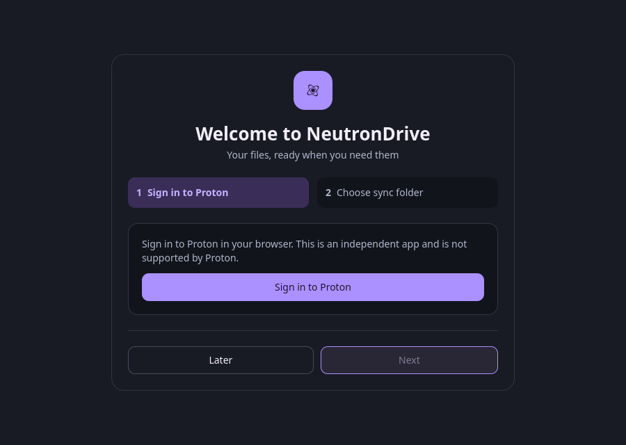
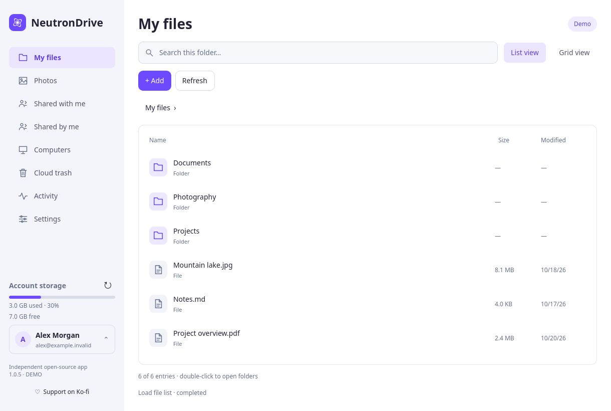
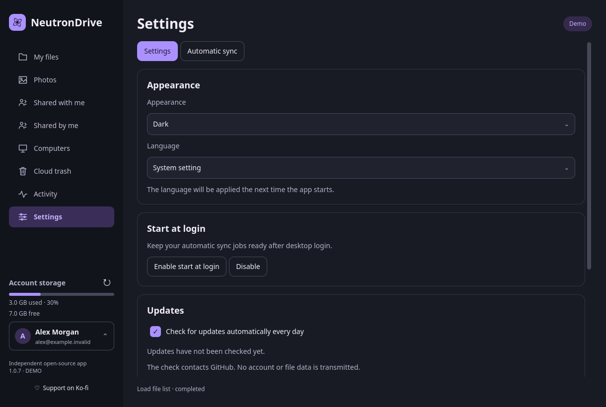

# Simpler desktop interface (1.0.6)

This source change takes visual inspiration from
[narrrl/proton-drive-linux](https://github.com/narrrl/proton-drive-linux): a focused
login screen, a quiet sidebar, and more space for files and photographs. It keeps
NeutronDrive's Rust controllers, Qt Quick components, branding and official
Proton browser authentication. No reference-project code was copied.

## Everyday workflow

- First launch shows a dedicated sign-in screen. After authentication, select
  the sync folder in a separate step and explicitly finish setup. Store-edition
  download and disk-space notices remain visible.
- Upload files, upload folders and create folders through **Add**. Individual
  actions still respect their existing permissions and busy-state guards. The
  file-action strip appears only after selecting an item.
- **Photos** and **Albums** remain directly accessible. Selection is opt-in;
  thumbnails have tighter spacing. **Import photos** opens the existing Google
  Takeout import flow. **View options** reveals thumbnail sizing. The current
  album name stays visible even when display options are closed.
- **Settings** starts with appearance, language, startup and updates. Technical
  connection diagnostics and preview-release preferences are under **Advanced
  settings**. Existing preferences are preserved when controls are collapsed.
- **Settings → Automatic sync** keeps the folder and service restart visible.
  Service controls, overview, online-drive configuration and additional folder
  setup are available under **Advanced settings**. Existing jobs remain visible.
- **Cloud trash → Local trash** opens local recovery files. A back button returns
  to cloud trash; the sidebar has one trash entry.

The change does not add backend photo capabilities, multi-account support or
other features merely because they exist in the reference application. Existing
albums, map links, cached thumbnails, lazy loading, sharing and sync behavior are
preserved. No real-account login or live cloud transfer was performed for this
interface-only change.

## Validation

- 105 Rust desktop unit tests passed; Clippy passed with warnings denied.
- 22 localization and native-packaging checks passed. All 25 language catalogs
  contain the new labels.
- Actual Qt window checks exercise light/dark setup at the minimum window size,
  file menus, advanced settings, sync controls, local-trash navigation, photo
  selection, albums, viewer, incremental loading and tray behavior.
- An isolated synthetic SDK fixture exercises file arguments and sharing.
- UI checks use private configuration, data, cache and state directories and a
  private session bus. They do not modify the installed app or account.

These interface changes are included in version 1.0.6.

## Interface previews

These captures come from the actual Qt application, with synthetic demo data.
The packaged release captures are refreshed during release validation.

